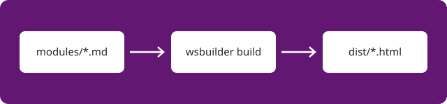

# Introduction

Welcome! Each module is a markdown file in `modules/`. The number at the start of
the file name sets the order, and the first heading becomes the title.

## Writing modules

Everything GitHub-flavored markdown offers works here: tables, task lists,
footnotes and code blocks with syntax highlighting.

```python title="greet.py"
def greet(name):
    return f"Hello, {name}!"
```

Callouts use GitHub's syntax:

> [!TIP]
> Blocks that show the output of a program can leave out the language, and they
> won't be highlighted.

Run `wsbuilder watch` and this page reloads every time you save.



## Before moving on

- [ ] Read this page
- [ ] Open `workshop.yaml` and fill in the details

The boxes stay checked between visits. When you're ready, continue to
[your first exercise](02-your-first-exercise.md).
